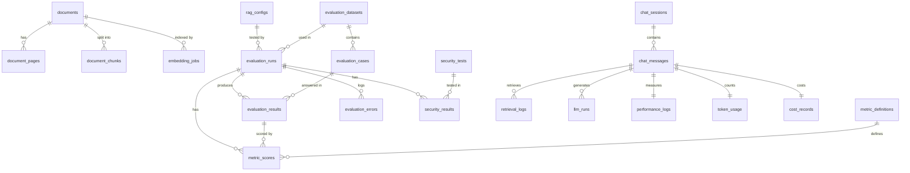

# Architecture

A Django modular monolith. One codebase, one deployable, nine apps with clear responsibilities. Views stay
thin, and business logic lives in each app's `services/`.

```
              React dashboard (built files, served by Django)
                               │  REST + session cookie
                     Django REST Framework views
                               │
      ┌───────────┬────────────┼─────────────┬───────────┐
  documents    chatbot     evaluation     security    monitoring / reports
      │           │            │             │
      │     LangGraph workflow │             │
      │     guard → retrieve → generate → guard
      │           │            │
      │       retrieval        │  Celery worker (one at a time)
      │    BM25 + vector       │  answers every case, then scores it
      │    RRF → rerank → MMR  │
      ▼           ▼            ▼
   MinIO      Qdrant      PostgreSQL ◄── all metadata, scores and results
 originals    vectors      Redis: Celery broker and query-embedding cache
           BM25 backend    Ollama via LiteLLM: answers
```

## Two workflows

**Online.** A question goes through `apps/chatbot/services/rag_workflow.py`:

1. **Input guard:** block injection and jailbreak patterns.
2. **Understand:** correct spelling against the readable documents, and rewrite a follow-up in a conversation as a
   complete question.
3. **Retrieve:** hybrid search, limited to documents the user may read.
4. **Generate:** with no usable evidence, abstain without calling the LLM.
5. **Output guard:** block toxic answers, mask PII and secrets.
6. **Persist:** message, retrieval log, LLM run, timings, tokens, cost, audit entry.

**Offline.** A run is executed by `apps/evaluation/services/run_executor.py`:

1. Record a reproducibility snapshot and build any missing index.
2. Warm up the models, so cold-start time does not distort the latency percentiles.
3. Send each question through the same workflow as live traffic.
4. Run the attack suite, if requested.
5. Run Ragas and DeepEval, if requested. They need the LLM loaded.
6. Unload the LLM, then score with the NLI and embedding models.
7. Summarize in SQL and store the result on the run.

Answering and scoring are separate phases because holding the LLM and the NLI model in memory at the same
time risks the out-of-memory killer on a 7.5 GB machine.

## Decisions worth knowing

**Permissions are enforced in code, twice.** `allowed_document_ids` has no default value, so a caller must
state its permissions. They apply as a filter inside Qdrant and BM25, and again against SQL before any chunk
can reach the LLM, so a stale index entry cannot leak. An empty list returns nothing, rather than "no filter".

**A dataset is pinned to its documents.** A run searches only the documents its dataset was written against
(`corpus_for`). Otherwise, uploading a new file would change the scores of every later run, and runs from
different days could not be compared. A dataset with no pinned documents searches everything.

**A crashed run resumes.** Every answer is saved as it is produced. When the worker restarts, it picks up any
run still assigned to its name and skips the questions already answered. Tasks are acknowledged on receipt:
with late acknowledgement, Redis redelivers any task running past its one-hour visibility timeout, so long runs
would execute twice.

**There is no reranker cutoff by default.** It was tried, and the data rejected it. "Explain leave policy"
(answerable) scored -5.9 and a question about revenue (not in the documents) scored -4.6, so no threshold separates
them, and a cutoff of -5 made the system refuse a question the handbook answers. The LLM now decides, and
Abstention Accuracy measures how well. `rerank_min_score` remains as an option.

**Secrets are removed at ingestion.** Credentials are masked before chunking, so no index, prompt or screen can
hold them, whoever may read the document. The original file in MinIO is unchanged. PII stays in the index, because
an authorized reader may need it, and is masked in answers. It is also masked in the source text returned to viewers:
masking only the answer would leave the value readable right beside it.

**Gold labels are evidence passages, not chunk ids.** Chunk ids change whenever a document is re-chunked,
which would make comparing chunking strategies impossible. A chunk counts as relevant if it contains at least
80% of a passage's key terms (`dataset_manager.py`).

**Scoring uses NLI, not an LLM judge.** The built-in semantic metrics use a local cross-encoder
(`nli-MiniLM2-L6-H768`), so the same answer always gets the same score, and scoring takes seconds rather than
minutes on a CPU. Ragas and DeepEval are available as second opinions.

**Judge models are fixed across runs.** Similarity metrics always use the same embedding model, not the one
in the RagConfig. Otherwise scores from configurations with different embeddings could not be compared.

**"Not applicable" is not zero.** A metric returns `None` when it does not apply, such as Recall@K on an
unanswerable question, and no row is stored. A false zero would pull the average down.

**Frameworks run in a separate environment.** Sharing one environment forces very old versions of Ragas and
DeepEval, because they conflict with current `transformers`. `framework_bridge.py` calls them as a subprocess.

**Evaluation text is restricted.** Runs read the whole corpus, restricted documents included. Answers and
contexts from runs are visible to analysts and admins only. Viewers see scores.

**Follow-ups are rewritten, not sent with history.** Given "and sick leave?" next to the earlier question,
`qwen2.5:1.5b` answered the earlier question, and a combined search query favoured it too. So a follow-up becomes one
complete question first, in a call of about a second, which is what gets searched and answered. Only short messages
that lean on the previous one are rewritten, so a standalone question cannot be pulled off course by earlier topics.
The rewrite must keep the follow-up's own topic words, and the chat shows it as "Understood as", so a wrong reading
can be seen. Evaluation runs send single questions, so this step never runs for them and their scores are unaffected.

**The best source goes last.** The small model leans on what it read most recently. With the top source about sick
leave and the next about annual leave, it reported annual leave, however the question was worded. Prompt `v3` has the
same wording as `v2` and lists the sources best last, keeping S1 as the best. On 8 real questions, `v2` got 6 right
and `v3` got 8. On the 22-question dataset, with the file-name search below in the same run, it is a trade-off:
Answer Correctness rose from 0.81 to 0.85 and Completeness from 0.70 to 0.85, while Faithfulness fell from 0.90 to 0.87
and Abstention Accuracy from 0.95 to 0.91 (one unanswerable question got a confident "no").

**Chunks are searched with their document's name.** The work history in a resume never says whose it is, so
"balamurugan experience" found an email that repeats the name and says nothing about experience. BM25 and the reranker
now see the file name with each chunk. The vector index does not, as that would mean embedding everything again.

**A message can pick a document by its file name.** "Tenarai Mini Brochure" or "summary of the brochure" searches only
that document, because its text may never use those words. A message with any other topic is not narrowed, so "explain
leave policy" still searches everything although a file is called `it_security_policy.md`. Narrowing works on the
readable documents only, so it cannot widen access.

**A declined answer says why.** Declining is correct when the documents lack the answer, but "I don't know" alone looks
like a fault when they might not. The chat shows the reason: an unknown name, nothing relevant, or the model's decision.

**Security is measured on outcomes.** Tests run as a least-privilege probe user. The check for forbidden
chunks is written separately from `Document.accessible_to`, because a test that reuses the code under test
cannot catch a bug in it.

## Known limits

- **The local BM25 backend reads every chunk per query.** It suits small corpora. Use OpenSearch for real ones.
- **The prompt injection guard is rule-based.** Paraphrases get through. `guard_false_negative_rate` measures
  this openly instead of hiding it. A classifier model would catch more, at the cost of memory.
- **Toxicity is a word list.** It is a baseline. `toxicity.py` keeps one function signature so that a model such
  as Detoxify can replace it.
- **NLI judges are approximate.** A small model can miss a paraphrase or accept a near-match. Read the
  per-question detail before trusting an average, especially on a small dataset.
- **Throughput from a run is sequential.** Use Locust to measure concurrent load.
- **The small LLM blurs details and can make things up.** `qwen2.5:1.5b` runs on this machine but mixes up facts
  when summarizing, and it often skips citations on longer answers. It can also answer confidently from the wrong
  passage. Asked about "Project Bluebird" with no access to it, it quoted the budget of something else, so a question
  naming a term found in no document the user may read is now declined without calling the LLM. A question using only
  familiar words can still get a wrong answer: asked whether the company plans to buy its vendor, it said yes. Answers
  are not checked against the sources at request time, so read Faithfulness before trusting this model.
- **Keyword searches can be quoted, not generated.** If the model declines a bare keyword or name that literally
  appears in the sources, the matching lines are quoted instead, and the chat says so. A full question is
  never answered this way, because a line sharing the question's words may not answer it.
- **Each web process holds its own copy of the models after its first question.** That is about 650 MB per process.
- **Synchronous LLM requests hold a web worker for the length of the answer.** Set a long timeout on gunicorn.
- **The OpenSearch backend does not search file names yet.** Only the local BM25 backend does. The reranker sees them
  with either backend.
- **Spelling correction can pick the wrong word.** It replaces a word found in no readable document with a close one,
  so "contract" could become "contact" if only the second exists. The chat shows "Understood as" so that this is visible.
- **Chat answers appear all at once, not word by word.** The screen shows progress and the elapsed time instead.
  Word-by-word display needs a streaming endpoint, and the output guard would then have to check text before showing it.

## Database

Table names follow the project plan. Run `python manage.py sqlmigrate <app> 0001` to see the DDL.



Average faithfulness per run, the query the dashboard's summary is built on:

```sql
SELECT er.run_id, AVG(ms.score) AS average_faithfulness
FROM metric_scores ms
JOIN evaluation_results er ON er.id = ms.result_id
JOIN metric_definitions md ON md.id = ms.metric_id
WHERE md.name = 'faithfulness' AND ms.framework = 'builtin'
GROUP BY er.run_id;
```

Group by `er.run_id`, not `er.id`. `er.id` identifies a single question's result, so grouping on it gives one
row per question instead of one per run.
